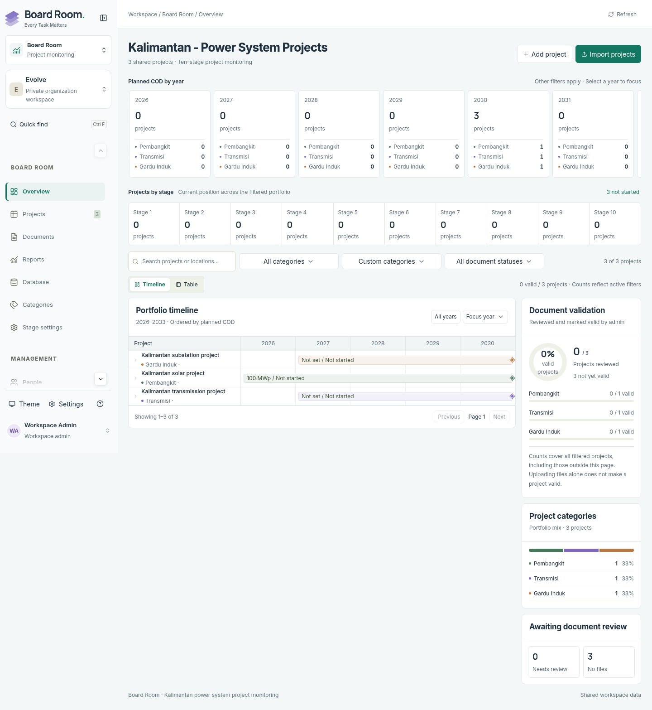

# Board Room implementation review

Completed 2026-10-23. The approved dashboard is titled **Kalimantan - Power System Projects**. Board Room is a native, authenticated Next.js application at `/board-room`, using Evolve's actual membership, PostgreSQL and private attachment services. Its project records remain separate from Locker Room's projects and tasks. The [super-app integration](SUPER_APP_REVIEW.md) now adds the shared post-login chooser, room switching and workspace-wide settings.

## Delivered behavior

- Timeline-first dashboard with expandable projects, timeline/table switching, year focus, search, filters, bounded pagination and full-filter counts. Timeline bounds include project start years as well as planned COD years.
- Clickable yearly cards with aligned Pembangkit, Transmisi and Gardu Induk counts. Missing categories and years have explicit fallbacks. Ten configurable stage counts, category distribution, document-validity charts and review queues share the dashboard filters.
- Admin project editing, ten shared stage names, stage selection and Undo; completed status after stage ten. Members can explore without mutation privileges. Server checks enforce these restrictions independently of the UI.
- Optional year-only schedules, numeric capacity with preset/custom units, location, description, labeled project links and multiple admin-managed custom categories. Category renames preserve assignments; assigned categories cannot be deleted.
- Database view with downloadable CSV template/example, header mapping, validation, complete paginated before/after previews, atomic merge by RUPTL Code and filtered CSV export. Imports preserve absent projects, blank fields and existing stages by default; stage replacement requires an explicit choice. Identical reimports do not bump project versions. Imports are bounded to 5 MiB/5,000 rows; exports support up to 5,000 filtered records per file.
- Actual private project upload/download/removal, review history and explicit admin validity review. A project needs a ready file before it can become valid. Changing the ready file set automatically invalidates the review; stale review requests are rejected.
- Responsive sidebar with Overview, Projects, Documents, Reports, Database, Categories and Settings. Light/dark preferences, keyboard dialogs, unsaved-form discard protection, loading/error/empty states and reduced-motion support.

[CSV template](../public/board-room/project-upload-template.csv) · [Example CSV](../public/board-room/project-upload-example.csv) · [Approved design](superpowers/specs/2026-10-23-board-room-design.md)

## Data and concurrency

Migration `0017_board_room.sql` adds dedicated projects, category assignments, configuration and history. It extends attachments with the Board Room entity type and a database trigger that invalidates document reviews when ready files change. Project/configuration versions reject stale edits, reviews and Undo; imports revalidate a server-generated preview snapshot before committing atomically. Existing Locker Room records are not converted.

Authenticated responses are private and uncached. Active membership is checked in services; mutations require admin privileges and same-origin requests. Board Room files reuse the existing private storage authorization. Project links are limited to HTTP(S). CSV exports guard spreadsheet-sensitive text.

## Verification evidence

| Check                          | Result                                                                                   |
| ------------------------------ | ---------------------------------------------------------------------------------------- |
| Type generation and TypeScript | Passed                                                                                   |
| Full ESLint, zero warnings     | Passed                                                                                   |
| Full domain/integration suite  | **156 passed**, zero failures                                                            |
| Production Next.js build       | Passed as Playwright prerequisite                                                        |
| Browser regression suite       | **37 passed** across Board Room, uploads, file management, entity deletion and workspace |
| Responsive checks              | 320, 390, 768 and 1440 px; no page overflow                                              |
| Automated accessibility        | Light/dark WCAG AA scans passed                                                          |

Board Room's six browser workflows cover authenticated editing and persistence; stage Undo inside project details; private upload and validation reset; custom-header CSV import and exact preview differences; filters changing during a delayed mutation; member/guest/outsider denial and wrong-Origin rejection; keyboard navigation; unsaved forms; and responsive themes. Integration tests additionally cover stale versions, file/review races, duplicate identities, idempotent imports, preview pagination beyond 100 rows and full aggregates beyond the 50-record page.

An independent code review identified import comparison, preview completeness, asynchronous refresh, Undo refresh, timeline bounds, category fallback and link-label issues. These were fixed with regression coverage before the final successful run.

All fixtures and screenshots use disposable synthetic data. Database tests use isolated PGlite or the explicitly named `evolve_test` / `evolve_e2e` PostgreSQL databases. Browser authentication uses signed test sessions; these checks do not constitute a real Google OAuth exchange or a production private Vercel Blob validation.

## Visual evidence

Desktop:

[Mobile screenshot](screenshots/board-room-mobile.png) · [Dark theme screenshot](screenshots/board-room-dark.png)

## Release state

Board Room is deployed as part of the approved Evolve super-app release, with migration 0017 applied after existing migrations 0001–0016. Existing auth/private-storage configuration is preserved. See [deployment and live checks](RELEASE_2026_10_23_SUPER_APP.md).

Migration 0017 is additive, but dropping it would destroy Board Room records and its attachment association. Prefer a forward repair; take a database backup before any separately authorized production migration. Older mockup files remain visual references; production persistence is provided by the native implementation above.

## Navigation design alignment — 2026-10-23

Measured Locker Room's live `/demo` navigation and aligned both the native Board Room and the standalone design preview: desktop width `clamp(248px, 18vw, 272px)`, 76 px collapsed desktop navigation, 72 px tablet rail, and a 320 px drawer constrained to the phone viewport. Navigation rows use 40 px minimum height and 13 px labels; branding, padding and the 64 px desktop top bar follow the same proportions. Locker Room and native Board Room reference shared width tokens. Keyboard users can open/close the drawer, dismiss with Escape and return focus to the trigger. Selecting a drawer item closes it.

Year cards now stay in a single horizontal row without a clipped second row as the sidebar expands. Category count alignment remains intact. Updated preview: [board-room-preview.vercel.app](https://board-room-preview.vercel.app). This separate site contains synthetic, browser-local data; it does not deploy the authenticated backend or change the live Evolve workspace.

Navigation verification: all **7 Board Room Playwright workflows passed**, including comparisons with Locker Room at 1280/1440/1640 px, 76 px collapsed navigation, 72 px rails, drawer width/focus/Escape checks down to 320 px, and a WCAG AA scan inside the phone drawer. Production build, TypeScript and full lint passed. The standalone preview's CSV/category/stage/document-review regressions also passed, as did navigation measurements at seven viewport widths with no script errors.

## Cross-app design and template audit — 24 October 2026

See [the current audit](CROSS_APP_DESIGN_AUDIT.md) and [the generated 14-column CSV guide](BOARD_ROOM_CSV.md) for shared typography, dark highlights, Home navigation, matching logos and complete workflow/link-label import/export support.
