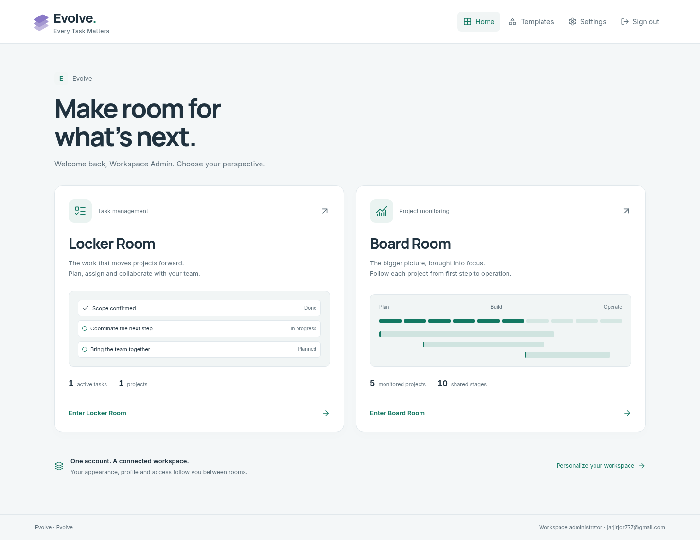

# Evolve: Locker Room + Board Room

## Delivered integration

Evolve now has one Google login and one authenticated workspace home at `/workspace`. Users choose **Locker Room — Task Management** or **Board Room — Project Monitoring**. Existing `/app`, `/board-room` and project deep links remain supported. Existing signed-in users visiting `/` reach the chooser; new Google sign-ins use `/workspace` as their callback. Invitation and administrator rules are unchanged.

A shared keyboard-accessible app switcher appears in both room sidebars. It links to the other room, workspace home, the template directory and shared settings. Locker Room switches use its existing unsaved-task leave guard. Mobile drawers retain focus correctly when the nested switcher closes. Signing out ends the same session for both rooms.

## Shared design and features

- `/workspace/settings` reuses the existing account/workspace settings UI and versioned persistence. Profile, theme, accent, compact density, sidebar preference, reduced motion, saved workspace branding and responsive sizing apply across both rooms. Admin configuration remains admin-only.
- `/workspace/templates` provides working entry points for Locker Room task templates and Board Room CSV/workflow templates, including downloadable CSV files and an admin stage-settings deep link. Task records and monitoring project records retain their different business rules.
- The global admin file manager recognizes Board Room projects, filters their files and displays their project names. Removing a reviewed Board Room document through this manager invalidates its review through the existing database trigger.
- The hub loads actual aggregate counts rather than full task/project lists. Both apps preserve their bounded data views and their own workflows.

No additional migration is introduced by this integration. The native Board Room requires additive migration 0017 after the released migrations 0001–0016. The original unreleased Board migration was renumbered to avoid colliding with production’s cost-precision migration.

## Bugs found and repaired

- Locker Room's startup effect overwrote saved appearance with a legacy `localStorage` theme. Saved account preferences now remain authoritative across room switches.
- Locker Room's mobile sidebar consumed Escape from portalled dialogs. It now leaves keyboard handling to the nested app switcher, retaining the drawer and restoring focus to its trigger.
- Board Room stage-settings links initially lost their section during dashboard refresh. Section-aware URLs now survive refresh/reload.
- The global file inventory classified Board Room documents as workspace logos and did not support filtering them. Board Room file contexts and filters are now explicit.
- Custom workspace branding and accent now appear in Board Room and shared surfaces, including portalled dialogs. Shared dark accent tokens meet the tested contrast requirements.

Responsive sidebar/content widths and standard type sizing continue to follow the existing Locker Room rules. Previously removed legacy width/text controls remain inactive; old configuration values are preserved without overriding responsive layouts.

## Verification

Status: **VERIFIED_LOCAL**, 2026-10-23.

| Check                             | Observed result                                                                                                                                            |
| --------------------------------- | ---------------------------------------------------------------------------------------------------------------------------------------------------------- |
| TypeScript and route generation   | Passed                                                                                                                                                     |
| Full ESLint, zero warnings        | Passed                                                                                                                                                     |
| Domain/integration tests          | **158 passed**, zero failures                                                                                                                              |
| Production Next.js build          | Passed before browser execution                                                                                                                            |
| Full browser audit                | **170 workflows executed**: 167 passed initially; three failures were repaired and retested                                                                |
| Final targeted browser regression | **43 passed**, zero failures, covering all three previously failing checks plus both rooms, shared settings, file management and form/layout compatibility |
| Responsive and accessibility      | 320/390/768/1440 px chooser and app layouts; keyboard/focus behavior; light/dark WCAG AA checks passed                                                     |
| Production dependency audit       | `npm audit --omit=dev --audit-level=moderate`: **0 vulnerabilities** reported                                                                              |

The full audit's three failures were an asynchronous camera-reset test reading before the visible frame settled; a new Google-entry test matching Next.js's route-announcer alert as well as the form alert; and an existing compatibility assertion preventing previously removed width/text controls from returning. The test synchronization/selector issues were fixed, the legacy sizing rule was preserved, and all three passed in the final 43-workflow run. Tests were strengthened or scoped to the intended UI; no assertions were disabled.

The nine new super-app browser workflows cover authenticated room entry and switching; shared dark/compact/motion/accent settings and stale versions; actual CSV download and stage-settings reload; unsaved task protection; responsive/keyboard/a11y checks; guests/outsiders/unverified/member role checks; wrong-Origin and unrelated-command rejection; isolated session sign-out across both APIs; mobile nested switcher Escape; and the Google sign-in callback request. Integration tests cover shared context, revoked membership, actual Board Room file inventory and review invalidation through global file removal.

An independent reviewer found the mobile Escape conflict and incomplete Board Room workspace branding. Both were repaired, with a regression test for Escape. No confirmed critical auth, CSRF, active-membership or settings-version bypass was found.

Browser fixtures use disposable `evolve_e2e`; integration fixtures use disposable databases or independent PGlite storage. The sign-out test creates its own synthetic session so it does not invalidate later tests. Tests do not impersonate the owner or validate a real Google authorization-code exchange, production Blob storage, or Google notification receipt.

## Native visual evidence

[Phone layout](screenshots/super-app-mobile.png) · [Board Room with shared navigation](screenshots/board-room-desktop.png) · [Dark Board Room](screenshots/board-room-dark.png)

## Release boundary

The approved release is deployed on the Evolve production domain, including additive migration 0017. See [exact deployment, migration and live verification evidence](RELEASE_2026_10_23_SUPER_APP.md). The standalone preview remains a separate browser-local prototype.

## Production-source reconciliation — 2026-10-23

The release candidate merges the exact observed production source `31449ae4e90847d4f39b9bd66b0ada0f3883d401`, preserving its cost precision, task date ranges, overview refinements, theme bootstrap and migrations 0015/0016. Board Room SQL is unchanged and renumbered to 0017. Health checks now require the Board tables, configuration, migration ledger entry and document-review trigger.

After reconciliation: **194 domain/integration tests passed**, **41 browser workflows passed**, TypeScript and zero-warning ESLint passed. Browser execution built the production application first and covered both rooms, shared settings, access controls, files, task ranges, large costs, long content and theme bootstrap. A fresh independent review found no critical or important code issues. All test databases were disposable; production was not used for fixtures.
